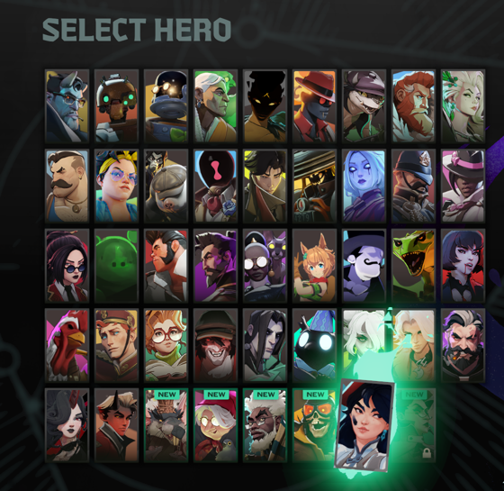

# Release Order Roster for Deadlock

Orders the hero roster **oldest main-roster release first**, with **English alphabetical names breaking same-day ties**. Covers 43 released heroes through Violet (October 16, 2026). Unknown or prerelease heroes remain visible at the end in their native relative order.

This is a **UI-only mod**. It contains the native roster popup layout with one script include, plus an ordering script. It does **not** ship hero definitions, balance data, a DLL, an injector, or an anti-cheat bypass.



## Install with Deadlock Mod Manager

1. Download `release-order-roster-0.2.1.zip` from [Releases](https://github.com/ZachZimm/deadlock-release-order/releases/latest).
2. Close Deadlock. Open **Deadlock Mod Manager → Mods Library → Add Local Mod**.
3. Select the ZIP, name it **Release Order Roster**, and choose **HUD** as its category.
4. Add it to the library, enable its toggle, and launch the modded game.

The manager assigns the installed VPK's name/order; the ZIP's `pak99_dir.vpk` filename is not a load-priority guarantee. Do not replace `gameinfo.gi` or a stock archive manually. Disable any older hero-definition-based version before using this one.

To disable or remove it, close the game, use the manager's toggle/removal control, then restart the game. Local imports do not receive automatic GameBanana updates. A public GitHub release is not a GameBanana catalog listing.

## Compatibility and scope

- Source/test target: **Steam build 26020302**, Linux/Proton. See [verification](docs/verification.md) for exact tested artifact and evidence.
- Keeps native cards **and their native grid wrappers** in their original sibling order, positioning them visually by release rank. Hover, quick search, click handlers, selection and cancel remain native. The same popup is used by more than one picker mode.
- This replaces `panorama/layout/popups/citadel_popup_roster_select.vxml_c`, so it conflicts with **Hero Select Plus** and other mods replacing that path. Disable conflicting replacements rather than relying on pak numbers.
- **Disable after an unverified game update.** Rebuild/retest if the native layout changes, and update release data for newly released heroes. UI-only does not mean update-proof.
- English alphabetical ties are intentional, even in another game language. Localized hero-name lookup is covered by unit tests; the recorded real-game checks use English.
- Online matchmaking, anti-cheat policy, and Valve approval are **not guaranteed**. Verification does not involve matchmaking. Gamepad-specific behavior is not separately certified.

## Build from your installed game

Requires Python 3.11+, .NET SDK 10, and Source 2 Viewer CLI 20.1. Node is required for tests. Building is headless and reads, but does not modify, the installed game.

```bash
mkdir -p .work/vrf
curl -fL https://github.com/ValveResourceFormat/ValveResourceFormat/releases/download/20.1/cli-linux-x64.zip \
  -o .work/cli-linux-x64.zip
printf '%s\n' '29d25a6d6b62377fc5386c3e5145b0a2180a401a50041afe9494b3f503deaef5  .work/cli-linux-x64.zip' | sha256sum -c -
unzip -o .work/cli-linux-x64.zip -d .work/vrf
chmod +x .work/vrf/Source2Viewer-CLI

export DEADLOCK_GAME="/path/to/SteamLibrary/steamapps/common/Deadlock"
dotnet restore src/UiPatcher --locked-mode
python3 tools/build.py --game "$DEADLOCK_GAME"
python3 tools/check_compatibility.py --game "$DEADLOCK_GAME"
(cd dist && sha256sum -c SHA256SUMS)
```

`--game` points at the directory containing `game/`, not `game/citadel/`. Use `--vrf /absolute/path/to/Source2Viewer-CLI` for a different CLI location. Full integration tests need [native fixtures](docs/test-fixtures.md):

```bash
node --test tests/roster_sort.test.cjs
python3 -m unittest discover -s tests -v
```

Builds use pinned NuGet dependencies, verify resource readback, independently extract the VPK, and compare all payload bytes. Fixed ZIP timestamps make identical-input builds reproducible. `data/validation.json` binds verification status to the exact VPK hash and source build; rebuilding changed code must not inherit a previous artifact's verified status.

The fingerprint checker compares the **base popup layout** against the release audit. An unchanged fingerprint does not establish new-hero completeness, all-component compatibility, or online policy.

## How it works

The current engine creates anonymous grid wrappers containing anonymous `CitadelHeroCard` panels. The script identifies native hero labels (or numeric IDs when available), resolves known heroes from the release manifest and localization, then assigns release-ranked visual positions to the existing direct grid children. It does not recreate, reparent, or move native card wrappers on the supported styled-panel path.

The native game reuses wrappers by sibling index during hero updates. Moving siblings, as version 0.2.0 did, caused the alphabetical/release-order flicker. Version 0.2.1 leaves that native index mapping alone and uses a non-flowing layout with measured card spacing and an explicit scroll extent. A guarded watchdog handles new wrappers, delayed geometry and resizing; normal hover changes do not need a corrective reorder. Unknown cards are retained stably, and non-hero controls keep their visual slots.

When upgrading, disable/remove the old local import before enabling the new ZIP, so only one version supplies the roster layout.

Exactly two VPK entries:

```
panorama/layout/popups/citadel_popup_roster_select.vxml_c
panorama/scripts/release_order.vjs_c
```

The layout uses its native compiled `LaCo` AST; the added VJS v4 resource contains raw UTF-8 JavaScript. No full hero table or localization override is included.

## Release dates and credits

“Release” means first normal **main-roster** availability, not Hero Labs previews, announcement dates, or internal hero ID order. The original 19 share the April 24, 2024 closed-playtest start date. Individual manifest entries retain their sources.

- [Deadlock Wiki — Heroes by release](https://deadlock.wiki/Heroes_by_release)
- [January 17, 2025 roster promotion](https://deadlock.wiki/Update:January_17,_2025)
- [October 16, 2026 / Violet release](https://deadlock.wiki/Update:October_16,_2026)
- [ValveResourceFormat / Source 2 Viewer](https://github.com/ValveResourceFormat/ValveResourceFormat)
- [Hero Select Plus](https://mods.frogtech.dev/hero-select-plus), researched as a compiled-Panorama format precedent; its implementation and hero table are not included.
- [Panorama panel declarations](https://github.com/ModDota/TypeScriptDeclarations/blob/master/packages/panorama-types/types/panels.d.ts)

Authored code is MIT licensed; the full notice is included in the download. Valve's original UI resources and imagery remain Valve's property and are not relicensed by this project. See [distribution notes](docs/distribution.md).
