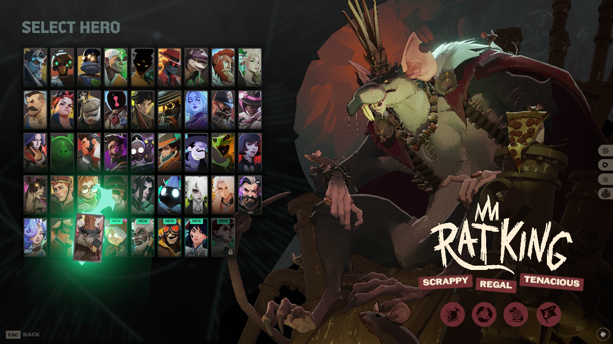

# Verification — Release Order Roster 0.2.0

## Artifact identity

Source/tested Steam build: **26020302** on both development and `lab` machines. The exact UI-only VPK tested in both engines has SHA-256:

```
928afd692d37ae0e23e6f91a2efaf6191c2495a1cd47665234440837a612282d
```

The manager assigned it `pak12_dir.vpk`; its bytes were identical to the release's `pak99_dir.vpk`. Archive filenames are not priority guarantees.

Verification claims are bound to the exact VPK hash and source build in `data/validation.json`; changed code/build input must not inherit old status. ZIP metadata/license changes do not change the tested VPK, but the final ZIP is also checked for import/packaging behavior.

## Actual runtime evidence

The initial ID-only implementation loaded successfully but did not sort this build: its direct grid children and inner hero-card panels had empty IDs. A temporary diagnostic recorded native `Panel → CitadelHeroCard → HeroName` structure. That diagnostic is not shipped.

The correction resolves native labels/localization, retains direct-wrapper identity and moves those wrappers in place. The compiled VJS v4 raw-source resource and added native-layout script include were exercised in the real engine; no compiler RED2 block was required for this tested resource.

On the development machine, the game ran under Proton on a separate Xvfb display with a read-only base filesystem and copied game/userdata/prefix overlay. `-insecure` was used for this test, **not claimed as offline**. The host's existing mod archives and gameinfo hashes were unchanged. All three sandbox launches exited with code 0 when stopped. SteamVR logging, shader-cache database and crash-dump-directory writes failed under the read-only sandbox; these component-level write errors did not prevent the real-game checks.

On `lab`, **Deadlock Mod Manager 1.1.0 (Flatpak)** imported the ZIP through its real Add Local Mod interface, enabled it, and launched the normal game through Steam. Steam's displayed custom-argument confirmation was for `-condebug`; no credentials or sign-in intervention was needed. No matchmaking was entered.

### Checked in-game

- Engine logs matched all **43** known hero IDs against manifest order programmatically, not by guessing portraits.
- Initial 19 first, then later release cohorts. The January 17, 2025 group is **Calico, Holliday, Sinclair, Vyper**.
- Newest five: **Rat King, Baba, Solomon, Deadman Danny, Violet**.
- Native locked **Nurse Harrow** remains visible after known releases, with lock/prerelease behavior intact.
- Ten actual hover-label captures verified slots 1, 23–26 and 39–43. See [contact sheet](hover-order.png).
- Native keyboard quick search still locates/highlights Violet; native mouse selection closes the picker and changes the room hero to Violet.
- Cancel/reopen and native rebuilds retain ordering. No `[release-order] Stopped` failure appeared in either test's game log.
- `lab` retained its existing cosmetic mods; this mod did not replace their payloads.



## Manager lifecycle and safety

- Imported ZIP with name **Release Order Roster**, author **ZachZimm**, category **HUD**.
- Readback verified one installed manager record and one added archive, `pak12_dir.vpk`, with the exact tested hash.
- Disable removed that archive and changed the record back to downloaded.
- Removal through the manager deleted this mod's record/archive. All pre-existing addon payload hashes remained unchanged; existing mod status values also matched their baseline.
- The manager launch added only a blank line to `gameinfo.gi`; token-level comparison was identical. No stock configuration replacement was supplied by the mod.
- Existing addons and manager state were backed up on `lab` before installation.

The final licensed ZIP (`b85ad7ba550d3efc2fd6e186ac9bd86607476aad148667d254a8a4c7781cc525`) was reimported through the real picker, enabled, and read back as the exact tested VPK. The manager process was stopped/restarted; its saved state, actual enabled toggle, and installed archive hash all persisted. The mod is left enabled on `lab`, with the game closed. The manager's whitespace-only gameinfo change was restored afterward, and readback confirmed original gameinfo bytes, every pre-existing addon payload and every pre-existing mod status matched the baseline.

## Automated checks

Final full run: **16 Python tests passed, 8 JavaScript tests passed**, and the Release .NET build reported **0 warnings and 0 errors**. Legacy prototype tests were removed from the public snapshot; these counts describe the current UI-only suite.

The suite checks native-layout preservation after removing the one added include, raw VJS v4 DATA bytes, resource readback, exact two-asset VPK allowlist, independent extraction equality, ZIP contents and license, release-rank injection, and positive/negative layout fingerprints.

JavaScript tests exercise actual anonymous-wrapper structure, localized-name fallback, stable unknown cards, non-hero slots, identity-preserving moves, hidden/destroyed lifecycle, same-count rebuilds, filters, missing grids, ignored moves and API failures. The packaged-script harness decompiles the actual VPK, executes that code in Node, and asserts full manifest order; deliberately removed ranks must fail the same check.

Manifest validation rejects empty data, duplicate/noninteger/Boolean/invalid IDs, bad/noncanonical dates and malformed names. Locked NuGet restore and Release builds are part of verification. Identical-input builds are compared for byte-identical VPK/ZIP output; current hashes are in `dist/SHA256SUMS`.

## Limits

No matchmaking/anti-cheat-policy certification, Valve approval, gamepad-specific certification, or real-engine non-English-locale certification is claimed. This still replaces one full UI layout and can conflict with other replacements. The native-layout fingerprint is not complete game-update compatibility enforcement. See [distribution notes](distribution.md).

The earlier whole-hero-definition prototype and its artifact/history are not part of the public release. Public screenshots here come from the current UI-only implementation.
